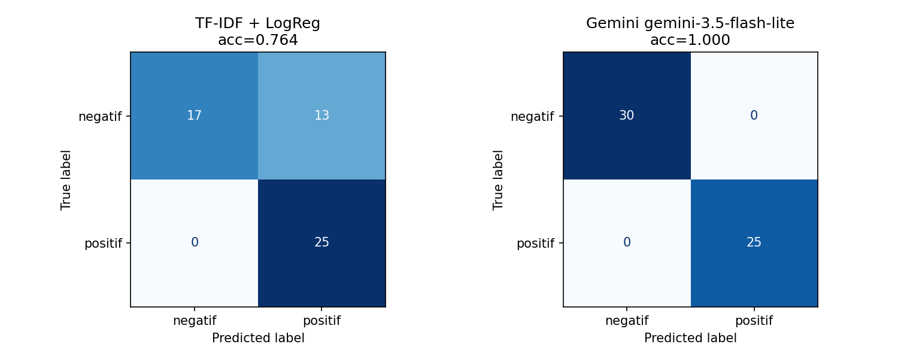

# Sentiment Analysis: Model Klasik vs LLM API

Eksperimen yang membandingkan dua pendekatan untuk mengklasifikasikan sentimen ulasan pelanggan e-commerce (positif/negatif):

1. TF-IDF + Logistic Regression (Scikit-learn)
2. Gemini API, zero-shot prompting

## Problem Statement

- **Objective**: mengklasifikasikan sentimen ulasan produk secara otomatis untuk ditampilkan di halaman produk, lalu memilih pendekatan yang layak dikembangkan ke produksi.
- **Target**: kolom `sentiment`, dua kelas, `positif` dan `negatif`.
- **Batasan/asumsi**:
  - Hanya memakai dataset yang dibagikan.
  - Label dianggap benar.
  - Tidak ada kelas netral.
  - LLM dipakai tanpa training.

## Dataset

`data/customer_reviews_sentiment.csv` ([sumber](https://docs.google.com/spreadsheets/d/1ry3h8o_MxeKR0bDolcZ8Au9giMgZl7Q0cyfjdhj1XLE/edit?usp=sharing)). Isinya 200 baris dengan kolom `review_id`, `product_name`, `review_text`, dan `sentiment`: 110 positif, 90 negatif.

200 baris itu hanya berisi **40 kalimat unik** (20 positif, 20 negatif), yang diulang dengan nama produk berbeda. Kalau data di-split acak per baris, 98% kalimat di test set sudah muncul di train, sehingga model klasik bisa mendapat skor 1.0 hanya dengan menghafal.

Karena itu split dilakukan **per kalimat unik**: 28 kalimat (145 baris) untuk train dan 12 kalimat (55 baris) untuk test, stratified, `random_state=42`. Kedua pendekatan dievaluasi di test set yang sama.

## Ringkasan Eksperimen

| | Model klasik | LLM API |
|---|---|---|
| Metode | TF-IDF unigram+bigram, Logistic Regression | `gemini-3.5-flash-lite`, zero-shot |
| Parameter | `max_iter=1000`, default lainnya | `temperature=0` (jawaban konsisten untuk input yang sama), `max_output_tokens=10` (jawaban cukup satu kata) |
| Training | 3 ms | tidak ada |

Prompt berisi definisi dua label, aturan untuk negasi (misalnya "tidak mengecewakan" = positif) dan ulasan campuran, serta instruksi menjawab satu kata. Output model dinormalisasi (lowercase, buang tanda baca) sebelum dievaluasi.

Awalnya dicoba `gemini-2.5-flash` sesuai starter notebook, tapi model itu sudah tidak tersedia untuk user baru. Lalu dicoba `gemini-3.8-flash`, yang ternyata memakai ~140 token *thinking* per ulasan (~6 detik) dan kuota free tier-nya hanya 20 request/hari. Akhirnya dipakai `gemini-3.5-flash-lite`.

## Hasil Evaluasi (test set: 55 baris / 12 kalimat unik)

| Pendekatan | Accuracy | Precision | Recall | F1-Score | F1 Macro | Inferensi/ulasan |
|---|---|---|---|---|---|---|
| TF-IDF + Logistic Regression | 0.764 | 0.658 | 1.000 | 0.794 | 0.759 | 0.004 ms |
| Gemini 3.5 flash-lite (zero-shot) | **1.000** | **1.000** | **1.000** | **1.000** | **1.000** | ~2 s |

Precision, Recall, dan F1-Score dihitung dengan `positif` sebagai kelas positif.



- **Model klasik**: 13 ulasan negatif diprediksi positif, sedangkan semua ulasan positif benar. Recall positif 1.0 hanya karena model condong menebak positif. Precision positif 0.658 artinya sepertiga prediksi positif sebenarnya keluhan.
- **Gemini**: semua ulasan test benar, juga benar di ke-40 kalimat unik dataset.

Cek stabilitas:

| Evaluasi | Accuracy | F1 Macro |
|---|---|---|
| Model klasik, split acak (bocor) | 1.000 | 1.000 |
| Model klasik, 5-fold CV per kalimat | 0.445 ± 0.088 | 0.441 |
| Gemini, seluruh 200 baris | 1.000 | 1.000 |

Di CV per kalimat, model klasik berada di bawah baseline kelas mayoritas (0.55). Skor 0.764 di test utama termasuk beruntung.

## Analisis Trade-off dan Limitation

**Performa.** Gemini unggul jelas. Kelemahan model klasik ada di jumlah data (hanya 40 kalimat unik), bukan di algoritmanya. Dari data sekecil itu, model belajar korelasi palsu, misalnya:
- `Respon penjual lambat dan terkesan tidak peduli komplain.` diprediksi positif karena kata `respon` (+0.55) di train hanya muncul di ulasan positif ("Fast respon", "Respon cepat").
- `Ukuran dan warna berbeda dari pesanan, sangat kecewa.` diprediksi positif karena `ukuran` dan `sangat` berbobot positif, sedangkan kata `kecewa` tidak pernah muncul di train.

| Aspek | Model klasik | LLM API |
|---|---|---|
| Effort | Butuh data berlabel + training ulang | Tanpa training, cukup prompt + parsing |
| Kecepatan | ~0.004 ms/ulasan, offline | ~1-2 s/ulasan, butuh network |
| Biaya | Hampir nol | Per token: ~132 input + 2 output per ulasan |
| Risiko | Gagal generalisasi ke kata baru | Kuota/rate limit (kena 429 saat eksperimen), model bisa di-deprecate, data dikirim ke pihak ketiga |

**Limitation eksperimen.**
- Test set hanya 12 kalimat unik, jadi satu kalimat menggeser accuracy sekitar 12%.
- Kalimat di dataset pendek, bersih, dan sentimennya jelas. Skor 1.0 Gemini belum tentu bertahan di ulasan asli yang sarkastik, campuran, atau memakai bahasa gaul.

## Rekomendasi

**Pakai Gemini flash-lite (zero-shot) untuk tahap awal**, sambil mengumpulkan data berlabel.

- Dengan data yang ada, hanya LLM yang terbukti bisa generalisasi ke kalimat baru. Model klasik rata-rata di bawah baseline.
- Kesalahan model klasik (keluhan tampil sebagai ulasan positif) paling merugikan untuk use case ini.
- Sentimen ulasan tidak perlu real-time. Prediksi bisa dijalankan batch sekali per ulasan lalu disimpan, jadi latensi 1-2 detik dan biaya per token masih wajar. Untuk produksi perlu paid tier.

Syarat sebelum go-live:
- Validasi di beberapa ratus ulasan asli yang dilabeli manual.
- Kunci versi model dan pasang retry untuk error 429.
- Setelah terkumpul ribuan ulasan unik berlabel, latih ulang model klasik. Kalau performanya mendekati LLM, pindah ke model klasik untuk menghemat biaya dan melepas ketergantungan pada API.

Analisis lengkap ada di `notebook/experiment_notebook.ipynb` Section 6-8.

## Struktur Project

```
model-experiment-assignment/
├── data/customer_reviews_sentiment.csv
├── notebook/experiment_notebook.ipynb
├── documentation/
│   ├── model_comparison_summary.png
│   └── llm_predictions.csv      # cache output Gemini (40 kalimat unik)
├── .env.example
├── README.md
└── requirements.txt
```

## Cara Menjalankan

```bash
pip install -r requirements.txt
cp .env.example .env    # isi GEMINI_API_KEY dari https://aistudio.google.com/apikey
cd notebook
jupyter notebook experiment_notebook.ipynb
```

Notebook memakai `documentation/llm_predictions.csv` sebagai cache. API hanya dipanggil untuk kalimat yang belum ada di cache, jadi notebook tetap bisa dijalankan ulang tanpa API key. Untuk memanggil ulang Gemini, hapus file cache tersebut.
